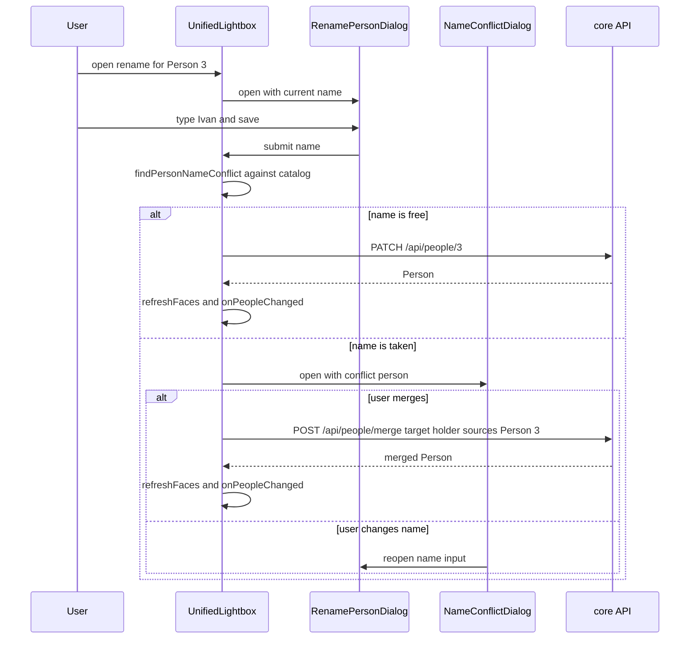

# Enforce Unique Person Names — Design

## The canonical key

A person's name gets a second, derived column:

```go
type Person struct {
    ID      uint   `gorm:"primaryKey" json:"id"`
    Name    string `gorm:"default:''" json:"name"`      // display name, as typed
    NameKey string `gorm:"default:'';index" json:"-"`   // normalized, never exposed
    // ... unchanged fields
}
```

`domain.NormalizePersonName(name string) (display string, key string)`:

1. `display = strings.Join(strings.Fields(name), " ")` — trims both ends and
   collapses every internal whitespace run (spaces, tabs, NBSP-adjacent runs,
   newlines) to one space. This is also the value stored in `name`.
2. `key = strings.ToLower(display)` — Go's per-rune Unicode lowering, so
   «Иван»/«иван»/«ИВАН» collapse to one key on any deployment.
3. An empty `display` yields an empty `key`, which means "unnamed" and is exempt
   from uniqueness.

`Person` implements `BeforeCreate`/`BeforeSave` so any path that uses
`Create`/`Save` keeps the key in sync. The catalog writes names through
`Updates(map[string]any{...})` (bulk update, no hooks), so it sets `name_key`
explicitly in the same map — the hook is a safety net for the rest of the code,
not the mechanism the API relies on.

### Why a derived column instead of a `lower(name)` unique index

The repository already has this pattern for logins
([`database.go`](../../../backend/core/internal/infrastructure/database/database.go:102)):
`CREATE UNIQUE INDEX idx_users_login_lower ON users (lower(login))`. It is not
reusable for people:

- `lower()` in PostgreSQL is collation dependent. Under `LC_COLLATE=C` — a very
  common container default — `lower('Иван')` returns `Иван` unchanged, so the
  index would accept «Иван» and «иван» as different names while the UI treats
  them as one.
- SQL cannot express the whitespace collapsing rule, so «Иван  Петров» and
  «Иван Петров» would still slip through.
- Unit tests run on in-memory SQLite
  ([`go-services.md`](../../../docs/agent/go-services.md:56)), whose `lower()`
  and collation behavior differ again; a Go-computed key behaves identically on
  both engines.

## Where uniqueness is enforced

| Entry point | Function | Conflict behaviour |
|---|---|---|
| `PATCH /api/people/:id` | `Catalog.Rename` | 409 `people.name_taken` |
| `POST /api/people` | `Catalog.CreateFromFaces` | 409, nothing created, faces stay unassigned |
| `POST /api/people/merge` | `Catalog.Merge` | 409, nothing merged |
| Startup repair | `database.repairPersonNames` | duplicates merged into the lowest id before the index is created |
| Database | partial unique index | rejects any write that bypasses the above |

`Catalog` gains one unexported helper:

```go
// findNameHolder returns the person other than excludeIDs that already holds
// the normalized key, or nil.
func (c *Catalog) findNameHolder(tx *gorm.DB, key string, excludeIDs []uint) (*domain.Person, error)
```

- `Rename`: `excludeIDs = []uint{personID}` (so re-casing your own name is
  allowed).
- `Merge`: `excludeIDs = append([]uint{targetPersonID}, sources...)` (the target
  and the sources being folded in cannot conflict with themselves).
- `CreateFromFaces`: `excludeIDs = nil`.
- The lookup is scoped to the person's own transaction and runs before any
  write, so a failed request leaves the catalog untouched.

The conflict travels as a typed error that keeps the offender:

```go
// ErrNameTaken reports that a normalized name belongs to another person.
type ErrNameTaken struct{ Existing *domain.Person }

func (e *ErrNameTaken) Error() string { ... }
func (e *ErrNameTaken) Unwrap() error { return ErrNameTakenSentinel }
```

`errors.Is(err, people.ErrNameTakenSentinel)` therefore still works in
`respondCatalogError`, and `errors.As` extracts `Existing` — the handler needs
that struct to build the response, and it must not issue a second query.

If the partial unique index fires anyway (a concurrent request won the race),
the catalog maps the driver's unique-violation error to the same `ErrNameTaken`
so the client sees one contract regardless of timing.

## HTTP contract

`409 Conflict` for all three endpoints:

```json
{
  "error": "people.name_taken",
  "conflict": {
    "id": 3,
    "name": "Иван",
    "photoCount": 12,
    "coverThumbnail": "/api/thumbnails?..."
  }
}
```

- `conflict` reuses the `PersonDTO` shape, so the client can render the existing
  person exactly like a tile in the grid.
- The `error` key is resolved to a localized message by the existing i18n layer,
  which keeps the plain-message fallback for clients that ignore `conflict`.
- `docs/api-contracts/core.yaml` gains a `PersonNameConflict` schema and the
  `409` response on the three paths; `make generate-types` refreshes
  [`webapp/src/types/api.ts`](../../../webapp/src/types/api.ts:1).

## Startup repair and the index

`InitDatabase` currently mixes `AutoMigrate` with raw index statements
([`database.go`](../../../backend/core/internal/infrastructure/database/database.go:85)).
The repair follows that shape, in a new
`backend/core/internal/infrastructure/database/people_names.go`, called right
after `AutoMigrate` and **before** the index statement:

1. **Backfill** — for every row where `name <> ''` and
   `name_key = '' or name_key <> computed`, recompute the key in Go (never in
   SQL: same collation argument as above) and write it back in batches.
2. **Group** — `SELECT name_key ... GROUP BY name_key HAVING count(*) > 1`.
3. **Merge each group into its lowest id**, reusing the same transactional steps
   as `Catalog.Merge`: faces of the losers get `person_id = survivor.id` and
   `manual_assignment = true`; the survivor's cover is taken from the first
   loser that has one when it has none; exemplars are unioned (unique by face,
   capped at five); the losers' exemplars and rows are deleted. The survivor is
   marked `manual = true`, because the job must not undo the repair.
4. **Index** — `CREATE UNIQUE INDEX IF NOT EXISTS idx_people_name_key_unique ON
   people (name_key) WHERE name_key <> ''`. Partial, so unnamed people remain
   unbounded.
5. The whole repair is idempotent: step 2 finds nothing on a clean catalog and
   step 4 repeats harmlessly. The current development database was verified to
   hold no duplicate named people, so the repair is a no-op there.

Failure policy: a failing merge is logged with the conflicting ids and skipped
(rather than aborting startup); the index statement follows the existing
`idx_users_login_lower` precedent and logs a warning instead of failing the boot
when unresolved duplicates remain. A skipped index never weakens the API: the
application check stays authoritative.

The `name_key` column is added by `AutoMigrate`, so both PostgreSQL and the
SQLite test database pick it up — the same way `manual` and
`manual_assignment` were introduced.

## Webapp

### API client

`handleResponse` currently collapses every failure into `new Error(message)`
([`client.ts`](../../../webapp/src/api/client.ts:54)), which loses the status and
the body. It gains:

```ts
export class ApiError extends Error {
  readonly status: number
  readonly body: unknown
}
```

- Thrown for every non-ok response, with the same translated message as today,
  so existing `catch` blocks keep working unchanged.
- `apiPost`/`apiPatch`/`apiDelete`/`apiPut`/`apiUpload` must re-throw an
  `ApiError` as-is instead of wrapping it in `translateNetworkError`, otherwise
  the status is lost again.
- A small guard `isNameTakenError(err): err is ApiError & { body: { conflict: PersonDTO } }`
  keeps the conflict shape in one place.

### Conflict detection helper

`webapp/src/lib/person-name.ts` mirrors the server rule:

```ts
export function normalizePersonName(name: string): string
export function findPersonNameConflict(
  name: string,
  people: PersonDTO[],
  excludeIds: number[],
): PersonDTO | null
```

Both catalog lists are already in memory on the two surfaces that name people
(`people` in `PeopleTab`, `catalog` in `UnifiedLightbox`), so the dialog can open
before the request is sent. The server remains authoritative: a 409 with a
`conflict` body opens the same dialog.

### The dialog

`PersonNameConflictDialog` joins the existing dialogs in
[`PeopleDialogs.tsx`](../../../webapp/src/components/people/PeopleDialogs.tsx:1):

| Prop | Meaning |
|---|---|
| `pendingName` | the name the user typed |
| `conflict` | the `PersonDTO` that already holds it |
| `mode` | `"merge-person"` / `"merge-selection"` / `"attach-faces"` — decides the wording of the first action |
| `loading` | request in flight |
| `onMerge` | fold the pending person, selection or faces into `conflict` |
| `onChangeName` | return to the name input with the typed value prefilled |
| `onCancel` | close everything, save nothing |

Copy follows the existing `people.*` namespace and is added to both locales. The
first action is not destructive (it loses no photos), so it is a normal primary
button; the second is the outlined "change the name" button.

### Flow: rename conflict, then merge



The same two alternatives apply when the server answers 409 because the catalog
in memory was stale: the `conflict` object from the body feeds the same dialog.

### Surface wiring

| Surface | Entry point | Local pre-check | Merge action |
|---|---|---|---|
| Lightbox, rename | `handleRenamePerson` in [`UnifiedLightbox.tsx`](../../../webapp/src/components/gallery/UnifiedLightbox.tsx:225) | `catalog` state | `mergePeople({targetPersonId: conflict.id, sourcePersonIds: [personId]})` |
| Lightbox, create from face | `handleCreateFromFace` in [`UnifiedLightbox.tsx`](../../../webapp/src/components/gallery/UnifiedLightbox.tsx:204) | `catalog` state | assign the face to `conflict.id` through the existing `assignFaceToPerson` path |
| People tab, tile/header rename | `handleRenameSubmit` in [`PeopleTab.tsx`](../../../webapp/src/components/tabs/PeopleTab.tsx:150) | `people` state | merge the renamed person into `conflict.id`, then drop it from `people` |
| People tab, create from faces | `handleCreateSubmit` in [`UnassignedFacesView.tsx`](../../../webapp/src/components/people/UnassignedFacesView.tsx:160) | `people` prop | attach the selected faces to `conflict.id` through the existing `assignFaceToPerson` loop |
| People tab, merge selection and merge-into | `handleMergeSubmit` / `handleMergeIntoSubmit` in [`PeopleTab.tsx`](../../../webapp/src/components/tabs/PeopleTab.tsx:170) | `people` state | re-issue the merge with `targetPersonId = conflict.id` and the former target added to the sources |

After any merge the People tab clears its selection and replaces the affected
rows with the returned person; the lightbox refreshes faces and notifies the
parent through `onPeopleChanged`, exactly as a successful rename does today.

### Edge cases

- Renaming a person to the same name in different case is not a conflict (self
  is excluded) and is saved as typed.
- Two clients racing: whichever loses gets the 409 with the holder, so the same
  dialog resolves it.
- The holder disappears between the conflict dialog opening and the merge: the
  merge answers 404 and the UI reports the existing `people.actionFailed` /
  `people.operationFailed` message and reloads the catalog.
- Clearing a name (`""`) never conflicts and never opens the dialog.
- A name at the 200-character limit follows the existing `maxLength` on every
  input; the trimming/collapsing happens on the server and in the helper, so a
  200-character display name with padded spaces is rejected consistently.

## Testing

- **Go unit tests (SQLite)**: normalization table (`""`, `"  Anna  "`,
  `"Anna   Petrova"`, `"ИВАН"`), conflict on each entry point including the
  `conflict` payload, self-rename in another case, unnamed exemption, merge
  where the requested name equals the target's or a source's name, the startup
  repair (duplicates merged into the lowest id, idempotent second run, unnamed
  untouched) and the index rejecting a direct duplicate insert.
- **Handler tests**: 409 status, error key, `conflict` fields; 200/201 unchanged
  on the happy path.
- **Vitest**: `normalizePersonName`/`findPersonNameConflict`, `ApiError`
  carrying `status`/`body` through `apiPatch`, the conflict dialog rendering
  both alternatives, and each surface's two paths (merge and change name) using
  the existing mocked `endpoints` module.
- **i18n parity**: the existing webapp translations test and the core locale
  test must pass with the new keys on both locales.
