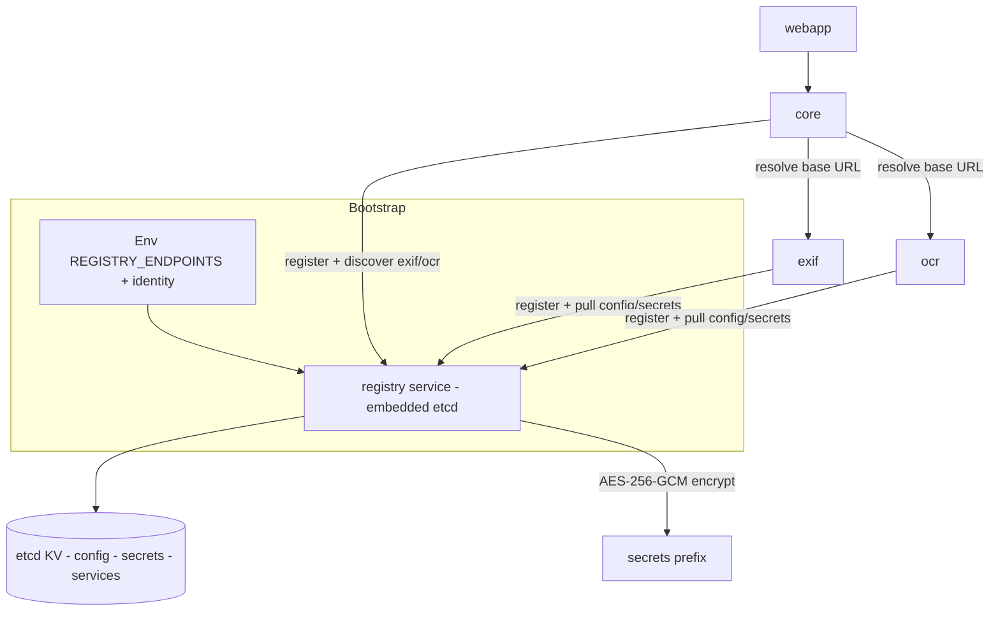

# Plan — Embedded etcd Registry Service (Service Discovery + KV Config)

## Intent

Replace the static, `.env`-driven microservice configuration with a single source
of truth: a new Go service `backend/registry` that embeds **etcd** (single-node,
cluster-ready later). It provides:

- **Service discovery** — every Go service registers itself with a TTL lease and
  discovers peers (e.g. `core` → `exif`, `ocr`) instead of hard-coded URLs.
- **KV config store** — all configuration, **including secrets**, lives in etcd
  and is watched for live reload. Secrets are encrypted at rest with app-level
  AES-256-GCM (etcd has no native encryption at rest).

Execution mode: **SDD cycle**
(`feature-branch` → `openspec-propose` → `openspec-apply-change` →
`openspec-sync-specs` → `openspec-archive-change`), confirmed with the user.

## Current state (findings)

| Concern | Location | Problem |
|---|---|---|
| Config source | [`config.go`](backend/core/internal/infrastructure/config/config.go:61) | 40+ env vars with hard-coded defaults; no central store, no reload |
| EXIF URL | [`config.go`](backend/core/internal/infrastructure/config/config.go:113) | static `EXIF_SERVICE_URL` default `http://localhost:5172` |
| OCR URL | [`config.go`](backend/core/internal/infrastructure/config/config.go:97) | static `OCR_SERVICE_URL` default `http://localhost:5174` |
| EXIF config | [`config.go`](backend/exif/internal/infrastructure/config/config.go:26) | env-only; no self-description, no registration |
| OCR config | [`config.go`](backend/ocr/internal/config/config.go:18) | env-only; only Host/Port |
| Inter-service clients | [`exifclient/client.go`](backend/core/internal/infrastructure/exifclient/client.go:25), [`ocr/client.go`](backend/core/internal/infrastructure/ocr/client.go:58) | constructors take a static base URL |
| Dual source of truth | [`app.go`](backend/core/cmd/server/app.go:52) | some runtime settings already live in Postgres `app_settings` |
| Dev orchestration | [`dev.sh`](scripts/dev.sh:36) | fixed service list, no registry lifecycle |

## Design decisions

### 1. New module `backend/registry`

- Module `github.com/flashbacks/registry`, mirroring the existing
  [`replace github.com/flashbacks/shared => ../shared`](backend/core/go.mod:30)
  pattern for consumers.
- Layout: `cmd/server/main.go`, `internal/config`, `internal/registry`
  (etcd embed), `internal/httpapi` (REST facade), `internal/secrets`
  (AES-GCM codec), exported `client/` package.
- Embeds etcd via `go.etcd.io/etcd/server/v3/embed`; single node, data dir
  `REGISTRY_DATA_DIR` (dev default `.run/registry-data`, git-ignored). Client
  port `2379`, peer port `2380`.

### 2. REST facade (not raw etcd gRPC from consumers)

Consumers talk HTTP (Gin), which centralizes etcd auth and secret encryption
and hides etcd internals:

| Method | Path | Purpose |
|---|---|---|
| GET | `/registry/v1/health` | liveness |
| PUT/GET/DELETE | `/registry/v1/config/{service}/{key}` | config CRUD |
| GET | `/registry/v1/config/{service}` | all keys for a service |
| GET | `/registry/v1/config/{service}/watch` | long-poll/SSE watch |
| PUT/GET/DELETE | `/registry/v1/secrets/{service}/{key}` | encrypted secrets (server-side AES-GCM) |
| PUT/DELETE | `/registry/v1/services/{service}/{instance}` | register / deregister (lease TTL) |
| GET | `/registry/v1/services/{service}` | discover instances |
| GET | `/registry/v1/services/{service}/watch` | watch instances |

### 3. etcd key layout

```
/flashbacks/
  config/<service>/<key>      # plaintext non-secret config
  secrets/<service>/<key>     # AES-256-GCM ciphertext
  services/<service>/<instance-id>   # JSON registration, lease-attached
```

### 4. Registration / discovery

- On boot each Go service, after bootstrap, calls
  `client.Register(ctx, instance)` with TTL (default 15s) and a keepalive
  goroutine; deregisters on shutdown.
- `core` resolves `exif`/`ocr` via `client.Discover("exif")` +
  `WatchInstances` instead of `EXIF_SERVICE_URL` / `OCR_SERVICE_URL`.
- Degradation: registry unreachable → fall back to env-provided bootstrap URLs
  and log a warning (layered config, no hard failure).

### 5. Config load / reload

- Bootstrap env stays minimal and registry-only: `REGISTRY_ENDPOINTS`,
  `REGISTRY_USER`, `REGISTRY_PASSWORD`, `SERVICE_NAME`, `SERVICE_ID`.
- `client.GetConfig(service)` + `WatchConfig` supply everything else with
  built-in defaults; watchers swap an atomic snapshot and invoke callbacks.
- Layering: explicit env override > etcd > built-in default (env override only
  for local debugging, discouraged for app params).

### 6. Secrets — encryption at rest

- etcd has no native encryption at rest; the registry implements AES-256-GCM
  with a master key from `REGISTRY_MASTER_KEY` (bootstrap env).
- Plaintext is never written to etcd; secrets are decrypted only inside the
  registry facade. Key rotation (re-encrypt) is a documented follow-up.
- etcd auth (RBAC: root + per-service users) and TLS (self-signed in dev, flag
  to disable) are enabled; secret values are never logged.

### 7. Consumer changes

- `core`: config comes from registry; `exifclient`/`ocr` clients gain a
  `BaseURLProvider func() string` (or a `ServiceResolver`) so discovery updates
  propagate; Wire graph updated and regenerated
  ([`wire.go`](backend/core/cmd/server/wire.go:13)).
- `exif` / `ocr`: fetch config, self-register, read secrets from registry.
- All keep env bootstrap fallback for local runs.

## Rollout phases

1. **A — Foundation**: registry service + facade + encryption + client lib +
   dev tooling + Dockerfile target + docs. No consumer changes yet.
2. **B — exif/ocr**: migrate the two simplest services.
3. **C — core**: migrate config, discovery, secrets.
4. **D — Cleanup**: remove static URL env defaults, finalize contracts/docs,
   archive.

## Architecture flow



## Contract / docs impact

- New OpenAPI [`docs/api-contracts/registry.yaml`](docs/api-contracts/registry.yaml).
- Update [`docs/architecture.md`](docs/architecture.md:5), [`README.md`](README.md:5),
  [`docs/agent/go-services.md`](docs/agent/go-services.md:11) (registry row + rules).
- Update [`Makefile`](Makefile:49) and [`scripts/dev.sh`](scripts/dev.sh:36)
  (registry lifecycle + start order), [`.env.example`](.env.example:1)
  (`REGISTRY_*` bootstrap vars), [`backend/Dockerfile`](backend/Dockerfile:50)
  (registry build target + runtime stage).
