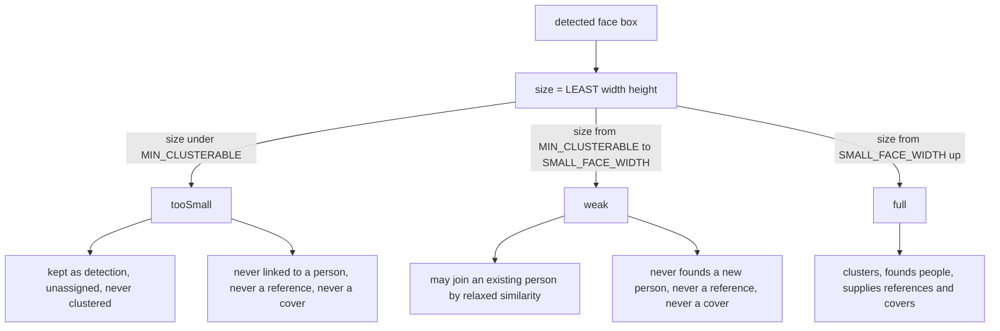

# Критерии «мелкого лица» — исследование, пороги, план

> Статус: **реализовано в коде и применено на production** (2026-11-06), порог 32 px,
> режим — прямые правки. Ручные привязки не тронуты, мелкие лица остались в галерее
> непривязанными. Миграция выполнена оператором по
> [`plans/small-faces-detach-migration.sql`](plans/small-faces-detach-migration.sql:1);
> результат сверен запросами — см. §8.
>
> Что сделано в коде:
> - faces: `MIN_CLUSTERABLE_FACE_PX = 32` + `FACES_MIN_CLUSTERABLE_FACE_PX`, роли
>   `tooSmall`/`weak`/`full` в `cluster_graph` (обе ревизии) и в `cluster`; группы без
>   full-лица отбрасываются; пороги отдаются в `/faces/health`.
> - core: `widths` = меньшая сторона бокса; `tooSmall` не попадает в кластеризацию;
>   `detachTooSmallFaces()` отвязывает автоматические привязки, `deleteEmptyPeople()`
>   удаляет людей без лиц (ручных не трогает); экземпляры и обложки только из full-лиц.
> - тесты: 8 Go + 13 pytest на критерии, остальные наборы зелёные.

## 1. Что известно из кода (проверено)

Текущее поведение: критерия «мелкое лицо» для кластеризации **не существует**.
`SMALL_FACE_WIDTH = 64` — это порог *только* для повторного эмбеддинга
([`config.py`](backend/faces/app/config.py:39), [`_describe_faces()`](backend/faces/app/engine.py:291)),
а не фильтр для кластеризации. Поэтому лицо 10×10 px сегодня идёт в кластеризацию
на равных и привязывается по «релаксированному» порогу 0.25
([`RECOGNITION_MIN_SIMILARITY`](backend/faces/app/config.py:57)) — это и есть источник неверных распознаваний.

Факты, нужные для правила:

| Факт | Где |
|---|---|
| Пороги кластеризации/распознавания живут в faces-сервисе, core читает их из `/faces/health` | [`reconcile.go`](backend/core/internal/application/faces/reconcile.go:90) |
| Core уже передаёт `widths` и `qualities` в `/faces/cluster-graph` | [`manager.go`](backend/core/internal/application/faces/manager.go:1065) |
| Faces-сервис принимает `widths`/`qualities`, но пока их не использует («reserved for quality-aware rules») | [`engine.py`](backend/faces/app/engine.py:563) |
| `faceRef` в core уже несёт `width` и `confidence` | [`manager.go`](backend/core/internal/application/faces/manager.go:566) |
| `person_references.quality` = `det_score` | [`reconcile.go`](backend/core/internal/application/faces/reconcile.go:318) |
| Кластеризуются только `person_id = 0 AND manual_assignment = false` | [`manager.go`](backend/core/internal/application/faces/manager.go:728) |
| Есть готовый рычаг «сбросить сгенерированных людей и кластеризовать заново»: `FACES_RECLUSTER_ALL` | [`manager.go`](backend/core/internal/application/faces/manager.go:341) |
| `people.manual = true` = человек создан/переименован пользователем, job его не трогает | [`faces.go`](backend/core/internal/domain/faces.go:30) |

**Схема (из GORM-моделей, [`faces.go`](backend/core/internal/domain/faces.go:24)):**
`people(id, name, manual, cover_face_id, cluster_version, created_at, updated_at)`,
`faces(id, image_file_id, person_id, manual_assignment, x, y, width, height, confidence, embedding_id, ...)`,
`person_references(id, person_id, face_id, dimension, embedding halfvec(512), quality, ...)`,
`face_embeddings(id, face_id, dimension, embedding halfvec(512), model, ...)`.

**Важная деталь:** `faces.width/height` хранятся в «сыром» кадре — EXIF-ориентация не применяется
([`decode_image()`](backend/faces/app/engine.py:242)), а core пересчитывает боксы в upright-кадр при выдаче
([`framing.go`](backend/core/internal/application/faces/framing.go:70)). Для повёрнутых фото (orientation 5–8)
`width` и `height` меняются местами, поэтому мерить размер надо как `LEAST(width, height)`, иначе правило
будет пропускать мелкие лица на портретных фото со поворотом.

## 2. Замеры production (факт)

Инвентаризация: **52 407** лиц, из них **44 773** привязано и **7 634** свободно; **14 949** лиц
имеют ручную привязку (`manual_assignment`, 28.5 %); **1 727** людей, из них **7** ручных;
**7 588** экземпляров (`person_references`); **52 407** эмбеддингов.

### 2.1. Распределение размера лица (`LEAST(width, height)`, px)

| размер, px | лиц | привязано | ручных | доля |
|---|---|---|---|---|
| < 8 | 13 | 12 | 4 | 0.02 % |
| 8–11 | 65 | 47 | 27 | 0.12 % |
| 12–15 | 253 | 188 | 56 | 0.48 % |
| 16–19 | 490 | 366 | 80 | 0.93 % |
| 20–23 | 702 | 490 | 130 | 1.34 % |
| 24–27 | 713 | 494 | 137 | 1.36 % |
| 28–31 | 814 | 563 | 179 | 1.55 % |
| 32–39 | 1734 | 1174 | 357 | 3.31 % |
| 40–47 | 1819 | 1259 | 402 | 3.47 % |
| 48–55 | 1958 | 1350 | 455 | 3.74 % |
| 56–63 | 1865 | 1319 | 406 | 3.56 % |
| 64–79 | 3170 | 2410 | 747 | 6.05 % |
| 80–111 | 6321 | 5296 | 1428 | 12.06 % |
| 112–159 | 6947 | 6028 | 1892 | 13.26 % |
| 160+ | 25543 | 23777 | 8649 | 48.74 % |

Итого мельче 32 px — **3 050** лиц (5.8 %), из них привязано **2 160**; мельче 64 px — 10 426 лиц.

### 2.2. Цена порога

| порог | отвязать лиц | затронуто людей | из них ручных привязок | людей останется без лиц | ручных среди них |
|---|---|---|---|---|---|
| 16 | 247 | 82 | 77 | 0 | 0 |
| 20 | 613 | 173 | 142 | 6 | 0 |
| 24 | 1 103 | 283 | 222 | 9 | 0 |
| 28 | 1 597 | 375 | 310 | 13 | 0 |
| **32** | **2 160** | **463** | **413** | **24** | **0** |
| 40 | 3 334 | 600 | 637 | 42 | 0 |
| 48 | 4 593 | 743 | 916 | 68 | 0 |
| 64 | 7 262 | 970 | 1 539 | 162 | 0 |

Ни у одного человека нет ровно одного лица (минимум два), поэтому «удаление людей без лиц»
затрагивает только тех, у кого **все** лица мелкие: 24 человека из 1 727 (1.4 %) при пороге 32 px
и 162 (9.4 %) при 64 px. Ручных людей среди них нет ни на одном пороге.

### 2.3. Согласие мелкого лица со своим же человеком (главный аргумент)

Для каждого лица мельче 64 px считается лучший косинус к лицам **того же человека** размером ≥ 64 px
(то есть к «сильным» лицам, а не к самому себе). Ниже 0.25 — это уже заведомо не тот человек:
порог привязки 0.25 сам по себе выше максимума между разными людьми (0.15 по калибровке репозитория).

| размер, px | лиц | средний лучший косинус | ≥ 0.25 | ≥ 0.30 | ≥ 0.40 |
|---|---|---|---|---|---|
| < 20 | 498 | 0.356 | 78.5 % | 70.1 % | 34.1 % |
| 20–23 | 416 | 0.377 | 79.1 % | 68.8 % | 39.2 % |
| 24–27 | 440 | 0.425 | 85.5 % | 78.9 % | 52.5 % |
| 28–31 | 475 | 0.454 | 89.1 % | 83.2 % | 58.5 % |
| 32–39 | 1 027 | 0.483 | 90.8 % | 86.4 % | 65.0 % |
| 40–47 | 1 132 | 0.513 | 91.0 % | 87.6 % | 66.3 % |
| 48–55 | 1 182 | 0.548 | 93.3 % | 89.8 % | 74.5 % |
| 56–63 | 1 204 | 0.578 | 95.9 % | 93.9 % | 79.5 % |

Отсюда: при < 24 px каждый пятый привязанный мелкий кадр (21 %) не дотягивает даже до 0.25 к
своему человеку — это доказуемо чужая привязка; на 24–31 px таких 11–15 %; на 32–63 px — 4–9 %.

### 2.4. Что не годится как критерий

- **`det_score` не различает масштаб:** медиана 0.744 у лиц < 32 px против 0.765 на 32–63 и 0.824 на
  ≥ 64; доля ниже 0.7 — 40 % / 36 % / 16 %. Порог уверенности отсекал бы корректные крупные лица
  почти так же часто, как мелкие, поэтому как отдельный критерий не нужен (только для выбора обложки).
- **`width` без `height`:** 6 118 лиц (11.7 %) имеют `width > height` (повёрнутые кадры, ориентация
  не применяется). Правило по одной `width` пропустило бы 15 лиц мельче 32 px и 31 мельче 64 px —
  немного, но `LEAST(width, height)` корректен по построению и ничего не стоит.
- **Экземпляры:** 525 из 7 588 (при пороге 32 px) указывают на лица мельче порога; у 40 людей
  все экземпляры мелкие, их набор надо пересобрать из выживших лиц.

## 3. SQL-пакет для повторного dry-run

```sql
-- Q1. Инвентаризация
SELECT count(*) AS faces_total,
       count(*) FILTER (WHERE person_id > 0) AS faces_assigned,
       count(*) FILTER (WHERE person_id = 0) AS faces_unassigned,
       count(*) FILTER (WHERE manual_assignment) AS faces_manual,
       (SELECT count(*) FROM people) AS people_total,
       (SELECT count(*) FROM people WHERE manual) AS people_manual
FROM faces;

-- Q2. Распределение размера лица (LEAST(width,height), px)
WITH sized AS (
  SELECT id, person_id, manual_assignment, LEAST(width, height)::numeric AS size FROM faces
)
SELECT CASE
         WHEN size <  8 THEN 'a. <8'      WHEN size < 12 THEN 'b. 8-11'
         WHEN size < 16 THEN 'c. 12-15'   WHEN size < 20 THEN 'd. 16-19'
         WHEN size < 24 THEN 'e. 20-23'   WHEN size < 28 THEN 'f. 24-27'
         WHEN size < 32 THEN 'g. 28-31'   WHEN size < 40 THEN 'h. 32-39'
         WHEN size < 48 THEN 'i. 40-47'   WHEN size < 56 THEN 'j. 48-55'
         WHEN size < 64 THEN 'k. 56-63'   WHEN size < 80 THEN 'l. 64-79'
         WHEN size < 112 THEN 'm. 80-111' WHEN size < 160 THEN 'n. 112-159'
         ELSE 'o. 160+'
       END AS bucket,
       count(*) AS faces,
       count(*) FILTER (WHERE person_id > 0) AS assigned,
       round(100.0 * count(*) / sum(count(*)) OVER (), 2) AS pct
FROM sized GROUP BY 1 ORDER BY 1;

-- Q3. Ущерб на пороге: сколько лиц отвязать, сколько людей затронуто
WITH t(threshold) AS (VALUES (16::numeric),(20),(24),(28),(32),(40),(48),(64)),
     sized AS (SELECT id, person_id, manual_assignment, LEAST(width, height)::numeric AS size FROM faces)
SELECT t.threshold,
       count(s.id) FILTER (WHERE s.size < t.threshold) AS faces_to_detach,
       count(DISTINCT s.person_id) FILTER (WHERE s.size < t.threshold AND s.person_id > 0) AS people_touched,
       count(s.id) FILTER (WHERE s.size < t.threshold AND s.manual_assignment) AS manual_faces_affected
FROM t LEFT JOIN sized s ON true
GROUP BY t.threshold ORDER BY t.threshold;

-- Q4. Сколько людей останется без единого лица (кандидаты на удаление)
WITH t(threshold) AS (VALUES (16::numeric),(20),(24),(28),(32),(40),(48),(64))
SELECT t.threshold,
       count(*) FILTER (WHERE NOT EXISTS (
         SELECT 1 FROM faces f WHERE f.person_id = p.id AND LEAST(f.width, f.height) >= t.threshold
       )) AS people_emptied,
       count(*) FILTER (WHERE p.manual AND NOT EXISTS (
         SELECT 1 FROM faces f WHERE f.person_id = p.id AND LEAST(f.width, f.height) >= t.threshold
       )) AS people_emptied_manual
FROM t CROSS JOIN people p
WHERE EXISTS (SELECT 1 FROM faces f2 WHERE f2.person_id = p.id)
GROUP BY t.threshold ORDER BY t.threshold;

-- Q5. Сколько людей держится на одном-единственном мелком лице (самый рискованный класс)
WITH per AS (
  SELECT person_id, count(*) AS n, LEAST(min(width), min(height))::numeric AS smallest
  FROM faces WHERE person_id > 0 GROUP BY person_id
)
SELECT CASE WHEN n = 1 THEN '1' WHEN n <= 3 THEN '2-3' WHEN n <= 10 THEN '4-10'
            WHEN n <= 100 THEN '11-100' ELSE '100+' END AS person_size,
       count(*) AS people,
       count(*) FILTER (WHERE smallest < 32) AS with_face_below_32,
       count(*) FILTER (WHERE smallest < 64) AS with_face_below_64
FROM per GROUP BY 1 ORDER BY 1;

-- Q6. Экземпляры (person_references), которые перестанут быть валидными
SELECT count(*) AS refs_total,
       count(*) FILTER (WHERE LEAST(f.width, f.height) < 32) AS refs_below_32,
       count(*) FILTER (WHERE LEAST(f.width, f.height) < 48) AS refs_below_48,
       count(*) FILTER (WHERE LEAST(f.width, f.height) < 64) AS refs_below_64
FROM person_references pr JOIN faces f ON f.id = pr.face_id;

-- Q7. Распределение det_score — нужен, если добавляем порог уверенности
SELECT round(confidence::numeric, 1) AS conf, count(*)
FROM faces GROUP BY 1 ORDER BY 1;

-- Q8. Примеры худших привязок
SELECT f.id, f.person_id, round(f.width::numeric, 1) AS w, round(f.height::numeric, 1) AS h,
       round(f.confidence::numeric, 3) AS conf,
       (SELECT count(*) FROM faces x WHERE x.person_id = f.person_id) AS person_faces,
       f.manual_assignment
FROM faces f
WHERE f.person_id > 0 AND LEAST(f.width, f.height) < 32
ORDER BY LEAST(f.width, f.height) ASC LIMIT 50;
```

Эти же запросы повторяются как dry-run перед миграцией: их результат должен совпасть с §2.

## 4. Критерии и пороги



- **`tooSmall`** (`size < MIN_CLUSTERABLE_FACE_PX`, рекомендуется **32 px**, консервативный вариант 24 px):
  лицо остаётся в БД как детекция (видно в лайтбоксе), но не участвует в кластеризации и не может быть
  привязано. Уже привязанные такие лица отвязываются: при 32 px это 2 160 лиц, 24 человека без лиц, 0 ручных
  людей; при 24 px — 1 103 лица и 9 человек.
- **`weak`** (32…63 px): может *присоединиться* к существующему человеку по релаксированному порогу 0.25
  с обязательным зазором 0.05 (86–96 % этих лиц проходят 0.25 к своему человеку, так что привязка в основном
  верна), но не может *создать* человека, быть экземпляром (`person_references`) и обложкой. Именно это
  убирает класс ложных людей, собранных из мелких лиц.
- **`full`** (≥ 64 px): полноправный участник, единственный источник `person_references` и обложек.
- **Порог уверенности не вводим** (§2.4): `det_score` почти не зависит от размера и как критерий бесполезен.

Пороги принадлежат faces-сервису (как и остальные) и отдаются в `/faces/health`; core их не дублирует.
Правило применяется в `/faces/cluster-graph` (там уже есть `widths`, контракт не меняется) и в
`cluster()`-in-memory пути (параметр `widths` по аналогии с `solo_faces`).

## 5. Точки правки в коде (проверены)

| Что | Где |
|---|---|
| Пороги отдаются в `/faces/health` → `thresholds{}` | [`api.py`](backend/faces/app/api.py:171) |
| Core парсит их в `clusteringThresholds` | [`reconcile.go`](backend/core/internal/application/faces/reconcile.go:90) |
| Цикл кластеризации: отбор неотвязанных лиц | [`clusterAssign()`](backend/core/internal/application/faces/manager.go:718) |
| `faceRef` уже содержит `width` и `confidence` | [`manager.go`](backend/core/internal/application/faces/manager.go:566) |
| `widths`/`qualities` уже уходят в `/faces/cluster-graph` | [`manager.go`](backend/core/internal/application/faces/manager.go:1065) |
| Сброс и повторная кластеризация: `FACES_RECLUSTER_ALL` | [`manager.go`](backend/core/internal/application/faces/manager.go:341), [`resetGeneratedPeople()`](backend/core/internal/application/faces/manager.go:921) |
| Выбор обложки (не должен брать `tooSmall`) | [`chooseCover()`](backend/core/internal/application/faces/manager.go:599) |
| Запись экземпляров с `quality` | [`reconcile.go`](backend/core/internal/application/faces/reconcile.go:318) |

## 6. План работ (после выбора порога и режима)

1. faces: `MIN_CLUSTERABLE_FACE_PX` (`FACES_MIN_CLUSTERABLE_FACE_PX`, по умолчанию 32) и `weak`-граница
   `SMALL_FACE_WIDTH`; экспорт в `/faces/health`; юнит-тесты на роли.
2. faces: `cluster_graph` и `cluster` учитывают размер — `tooSmall` не получает ни одной метки,
   `weak` не бывает core-точкой/якорем и не попадает в `person_references`-кандидаты.
3. core: `clusterAssign` не отправляет `tooSmall` лица в кластеризацию; новый идемпотентный шаг отвязки
   уже привязанных `tooSmall` лиц (уважая `manual_assignment` и `people.manual` — см. открытый вопрос).
4. core: удаление людей без единого лица (с пересчётом `cover_face_id`, чисткой `person_references`,
   учетом `people.manual`).
5. core: тесты — отвязка, удаление, сохранение ручных людей, идемпотентность повторного прохода.
6. webapp: мелкие/непривязанные лица остаются видимы; если нужен новый статус — i18n en+ru.
7. Обновить `docs/agent/go-services.md` и `docs/agent/webapp.md` (если менялись правила компонента),
   `docs/api-contracts/faces.yaml`, `backend/faces/README.md`, `docs/faces/*calibration*.md`.
8. Production-операция: сначала Q1–Q8 (dry-run), затем применение через код (не сырым SQL):
   прогон c `FACES_RECLUSTER_ALL=true` покрывает сгенерированных людей, отдельный шаг — ручные;
   дамп БД перед операцией.

## 7. Решения, которые нужны

1. **Порог `MIN_CLUSTERABLE_FACE_PX`.** Рекомендация — **32 px**: доля доказуемо чужих привязок падает
   с 15–21 % (24–31 px) до 4–9 % (32–63 px), цена — 2 160 отвязанных лиц и 24 человека без лиц из 1 727.
   Консервативный вариант — **24 px** (1 103 лица, 9 человек), но 11–15 % привязок в полосе 24–31 px
   остаются заведомо неверными.
2. **Ручные привязки.** При 32 px под правило попадают 413 лиц с `manual_assignment = true` (19 % от
   отвязываемых) — это явные действия пользователя. Рекомендация: по умолчанию **не трогать**
   `manual_assignment` и `people.manual`, отвязывать только автоматические привязки; отдельным флагом
   разрешить «применить ко всем».
3. **Судьба мелких лиц.** Рекомендация — оставить в галерее как непривязанные детекции (сейчас таких
   890 лиц < 32 px уже непривязаны), чтобы боксы в лайтбоксе не исчезали.
4. **Удаление людей.** Ни у одного человека нет одного лица, поэтому удаление затрагивает только людей,
   у которых все лица мелкие: 24 при 32 px, 162 при 64 px; ручных среди них нет — рекомендация удалять
   безусловно, но с сохранением дампа перед операцией.
5. **Экземпляры.** Наборы `person_references` пересобрать только из `full`-лиц: 525 текущих экземпляров
   при 32 px невалидны, у 40 людей все экземпляры мелкие.

## 8. Результат миграции (production, проверено запросами)

| метрика | до | после | ожидалось |
|---|---|---|---|
| привязанных лиц | 44 773 | **43 026** | 43 026 |
| непривязанных лиц | 7 634 | **9 381** | 9 381 |
| людей | 1 727 | **1 703** | 1 703 |
| ручных людей | 7 | **7** | 7 |
| экземпляров | 7 588 | **7 063** | 7 588 − 525 |
| людей без лиц | 0 | **0** | 0 |
| автоматических привязок мельче 32 px | 1 747 | **0** | 0 |
| ручных привязок мельче 32 px | 413 | **413** | 413 |

Проверки целостности: экземпляры без лица или без человека — 0; экземпляр, чьё лицо
принадлежит другому человеку, — 0; экземпляров мельче 32 px — 0; обложек,
указывающих на чужое или отвязанное лицо, — 0; людей без обложки при наличии лиц — 0;
обложек мельче 64 px при доступном full-лице — 0; людей с автоматической привязкой
мельче 32 px — 0.

Остаётся выпустить faces и core на production: до деплоя новые критерии действуют только
на данные (миграция), а следующий проход распознавания со старым образом ещё способен
привязать мелкое лицо.
