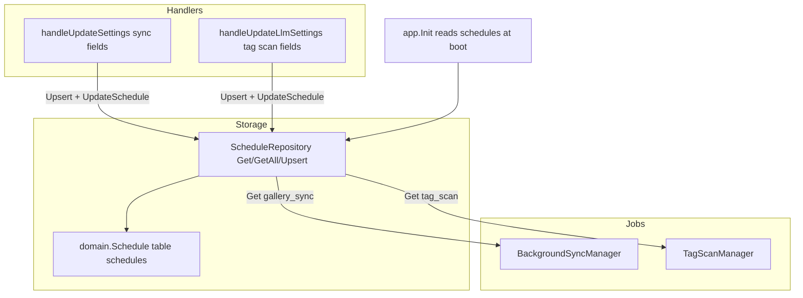

# Unified Backend Schedule Table — Design

## Context

Two background jobs are driven by stored schedules, each kept in its own place:

| Job | Storage today | Shape |
|---|---|---|
| Gallery sync | `app_settings` columns [`SyncDays`, `DailySyncHour`, `DailySyncMinute`, `SyncTimezoneOffset`](../../backend/core/internal/domain/media.go:136) | weekdays + single run time |
| Automatic tagging | `tag_scan_settings` columns [`Enabled`, `Days`, `StartHour`, `StartMinute`, `EndHour`, `EndMinute`, `TimezoneOffset`](../../backend/core/internal/domain/media.go:300) | weekdays + start–end window |

`OcrManager` and `EmbeddingBackfillManager` are on-demand and carry no schedule, so
the unified table starts with exactly these two kinds and stays open to more.

Both managers already share the same primitive concepts (weekday set encoded as a
comma string, hour/minute, timezone offset) and duplicate the same date math
(`ParseSyncDays` in [`background_sync.go`](../../backend/core/internal/application/imaging/background_sync.go:624),
`isWindowOpenAt`/`nextWindowOpenAt` in [`tag_scan.go`](../../backend/core/internal/application/imaging/tag_scan.go:424)).

## Goal / Non-goals

**Goal:** one `schedules` table and one `ScheduleRepository` as the single source of
truth for every recurring job, with the two managers consuming the same
`domain.Schedule` value and the same date/time helpers.

**Non-goals:**

- No change to the public API. `syncDays/dailySyncHour/dailySyncMinute/syncTimezoneOffset`
  and `tagScan.{enabled,days,startHour,startMinute,endHour,endMinute,timezoneOffset}` keep
  their current JSON shape, so the webapp and OpenAPI contract stay untouched.
- No change to the tagging window semantics or the sync single-run semantics.
- OCR/embedding-backfill are not converted to scheduled jobs in this change.

## Data model

New `domain.Schedule` (table `schedules`) in [`backend/core/internal/domain`](../../backend/core/internal/domain/media.go:1):

| Column | Type | Meaning |
|---|---|---|
| `id` | uint PK | row id |
| `kind` | string, unique index | `gallery_sync` or `tag_scan` (future: `ocr_classification`, ...) |
| `enabled` | bool, default true | job on/off (replaces `tag_scan_settings.enabled`) |
| `days` | string, default `'1,2,3,4,5'` | comma weekday numbers, `0`=Sunday…`6`=Saturday; empty = disabled |
| `start_hour` / `start_minute` | int | window open (sync: run time) |
| `end_hour` / `end_minute` | int | window close; `end == start` means "single shot" for sync |
| `timezone_offset` | int, default 0 | JS `getTimezoneOffset` sign (UTC+3 = `-180`) |
| `created_at` / `updated_at` | timestamps | |

`ScheduleKind` constants and helpers live beside the struct:

- `func (s Schedule) Weekdays() []time.Weekday` — `ParseSyncDays(s.Days)`
- `func (s Schedule) IsWindowOpenAt(now time.Time) bool` — weekday + window check (moved from `tag_scan.go`)
- `func (s Schedule) NextRunAt(now time.Time) time.Time` — single-shot next run (moved from `background_sync.go`)
- `func (s Schedule) NextWindowOpenAt(now time.Time) time.Time` — next window opening on a selected weekday

`ScheduleKind` is a string so the table is self-describing without a second enum table.

## Migration strategy

GORM `AutoMigrate` owns the schema; there are no standalone migration files. The
rollout is therefore idempotent and additive first:

1. Add `&domain.Schedule{}` to the `AutoMigrate` list in
   [`database.go`](../../backend/core/internal/infrastructure/database/database.go:39).
2. Add a seed step in `SeedDefaults`/`Init` that runs after AutoMigrate:
   - if no `gallery_sync` schedule exists, create it from `app_settings`
     (`SyncDays` → `days`, `DailySyncHour/Minute` → `start_*`, `SyncTimezoneOffset` → `timezone_offset`),
     defaulting to `1,2,3,4,5` at 03:00 when `app_settings` has no row.
   - if no `tag_scan` schedule exists, create it from `tag_scan_settings`
     (`Enabled`, `Days`, `StartHour/Minute`, `EndHour/Minute`, `TimezoneOffset`).
3. Mark the seed idempotent: it fills only when a `kind` row is missing, so it can
   run on every boot without clobbering edits.
4. Legacy cleanup (optional, after the code no longer reads the columns):
   `db.Exec("DROP COLUMN IF EXISTS ...")` is **not** run automatically in this change.
   The columns stay in Postgres and are simply unused; a follow-up can drop
   `app_settings.sync_days/daily_sync_hour/daily_sync_minute/sync_timezone_offset`
   and the whole `tag_scan_settings` table once the release has been proven.
   Rationale: AutoMigrate never drops columns/tables, and an in-band `DROP` would
   destroy the rollback path.

## Repository

New [`backend/core/internal/domain/repository/schedule_repo.go`](../../backend/core/internal/domain/repository/schedule_repo.go:1):

```go
type ScheduleRepository interface {
    Get(kind domain.ScheduleKind) (*domain.Schedule, error)
    GetAll() ([]domain.Schedule, error)
    Upsert(s *domain.Schedule) error
}
func NewScheduleRepository(db *gorm.DB) ScheduleRepository
```

- `Get` returns `gorm.ErrRecordNotFound` for an absent kind; callers fall back to a
  zero/default schedule.
- `Upsert` is the single write path; both settings handlers route schedule saves here.

## Manager API

Both managers stop taking exploded `(days, hour, minute, tzOffset)` tuples and take a
whole schedule:

- `BackgroundSyncManager.Start(s domain.Schedule)` / `UpdateSchedule(s domain.Schedule)`
- `TagScanManager.Start(s domain.Schedule)` / `UpdateSchedule(s domain.Schedule)`

Each manager keeps its own loop and only reads fields it needs (sync uses
`StartHour/Minute`; tagging uses the full window). `Enabled` gates both, and an empty
`days` set keeps the loops parked exactly as today.

## Wiring

- `app.Init()` reads `ScheduleRepository.Get(ScheduleGallerySync)` and calls
  `BackgroundSync.Start(s)`, and `Get(ScheduleTagScan)` → `TagScanManager.Start(s)`.
- `handleUpdateSettings` (sync): on schedule change, build a `domain.Schedule`, call
  `ScheduleRepository.Upsert`, then `backgroundSync.UpdateSchedule(s)`.
- `handleUpdateLlmSettings` (tagging): same pattern for the tag-scan schedule.
- `SettingsLoader.TagScanSettings()` and the sync defaults are replaced by
  `ScheduleRepository.Get(...)` + a default fallback; the `tagScan` response and the
  settings response keep the exact same JSON fields.

## Verification

- New `ScheduleRepository` unit tests on in-memory SQLite: `Get`/`Upsert`/`GetAll`,
  weekday round-trip, empty-days meaning.
- Migrated seed tests: booting with populated legacy rows produces the two schedule
  rows; booting twice does not duplicate or overwrite edits.
- Existing manager tests keep passing after the signature change (they already assert
  the same `calculateNextRunTime`/`isWindowOpenAt`/`nextWindowOpenAt` behavior).
- Handler tests assert the public DTOs are unchanged.
- `go vet ./...`, `go test ./internal/application/... -count=1`,
  `go test ./internal/interfaces/... -count=1`.

## Rollback

Redeploying the previous build is safe: it reads `app_settings`/`tag_scan_settings`
directly and ignores `schedules`; the new seed only ever inserts, so nothing it wrote
breaks the old code. The `schedules` table is additive.

## Architecture


